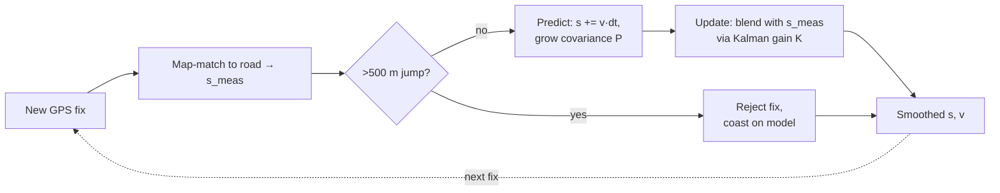
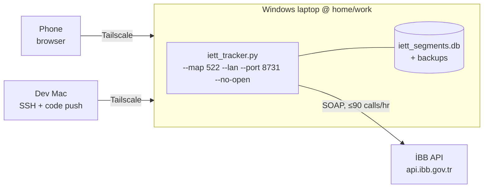

# İETT 522 Tracker

Live map and arrival predictor for the İETT **522** bus. Runs on a Windows laptop, viewed from your phone over Tailscale.

**Documentation map**

| Read this | For |
| --- | --- |
| [GUIDE.md](GUIDE.md) | Plain language. What the screen means, the four kinds of ETA, how much to trust the number, what to do when it looks wrong. |
| **README.md** (this file) | The data source, the learning model, the ETA band maths, the Kalman filter, and the war stories. |
| [PREDICTION.md](PREDICTION.md) | Technical reference for the prediction and bias-correction pipeline, the measured calibration, and how to re-measure it. |
| [PRODUCT.md](PRODUCT.md) | Design direction and principles for the interface. |

> **§3 and §7 cover the model as of 16 Jun 2026.** Everything added since (origin-wait, the
> four-part bias-correction stack, the measured calibration) lives in
> [PREDICTION.md](PREDICTION.md); §7's constant table is extended there. §4, §5 and §8 were
> corrected on 20 Jul 2026 for the current SYSTEM boot-task deployment.

---

## 1. What this is & why it exists

A live tracker and arrival predictor for the **522** bus (Alemdağ ⇄ Mecidiyeköy), viewable on your phone.

**Why it exists.** The major transit apps (Google Maps, Moovit) don't show live bus positions for the 522 — only schedules and rough estimates. The LED screens at the stops are unreliable: they drop out often and don't match when buses actually arrive. There was no way to know where the bus actually was, or when it would actually show up.

İBB publishes live bus GPS through a public API; the apps just don't surface it well. This pulls that data directly, puts the buses on a map, and records how long each stop-to-stop segment actually takes. It uses that history to predict arrivals — including when the live feed is down, which is often.

**What it does.**
- Shows live 522 positions on a map.
- Predicts when the next bus reaches your stops — as a range with a confidence level, not a single fake-precise number.
- Falls back to learned and scheduled predictions when the live feed drops.

**Scope.** One route (the 522), one user. It runs continuously on a Windows laptop and is reached from your phone over Tailscale. To run it for a different line, see [Redeploy from scratch](#5-redeploy-from-scratch-the-dead-laptop-runbook) and the [Config reference](#7-config-reference).

## 2. Using it

Open `http://<TAILSCALE-IP>:8731/` on your phone, with Tailscale connected (see [§4](#4-the-setup--where-it-runs) for what that address is). It's a web page — nothing to install. Add it to your home screen for one-tap access.

**The card at the top — the main thing.**
- The **big number** is minutes until the next bus reaches your selected stop. It's a **range** when there's enough data (e.g. "7–9"), a single number otherwise.
- The **two buttons** toggle between your stops — **→ Mecidiyeköy** (morning) and **→ Home** (evening).
- The **badge** says where the number comes from: **live ✓** (learned from real data), **timetable**, **headway**, or **est** (projected during an outage).
- The **coloured dot** is confidence: green = high, amber = medium, grey = low.
- Below it: how many **stops away** the bus is, and when the **last bus passed**.
- The **status line** shows the state: *live*, *stale* (GPS position is old), or *İBB down* (running on fallback).
- The **bottom line** is the self-measured accuracy ("±X min").

**The map.**
- **Green arrows** = buses going your way; **red** = the other direction (for the 522 config, green = toward Mecidiyeköy).
- Arrows **glide** as buses move and point in the direction of travel.
- **Dimmed** arrows are stale or projected (estimated position during an outage), tagged "est".
- Your stops are marked (a star for the home boarding stop, coloured dots for the others). **Tap any stop** to see the buses approaching it with ETAs.
- The route line is drawn underneath.

**The activity dot** (bottom of the card):
- **Breathing green** = live and fresh.
- **Bouncing dots** = fetching right now.
- **Blinking red** = can't reach İBB or the server.

**When İBB's feed is down** (often), the app doesn't go blank: buses keep moving as projections, and ETAs fall back to headway or timetable. The status line and the "est" tags tell you when you're looking at estimates instead of live data.

## 3. How it works (the clever bits)

The whole thing is one Python file (`iett_tracker.py`). In `--map` mode it runs three things at once: a **collector** that polls İBB and learns, a **web server** that serves the map and predictions, and **background jobs** (DB backups, accuracy logging).

**The data source.** İBB's SOAP API (`api.ibb.gov.tr/iett`). One method returns live bus positions for a line (`GetHatOtoKonum_json`); others return the route's stop list, geometry, and timetable. The live-position service is **rate-limited to 100 requests/hour** — and the app deliberately stays around **90/hr** as a safety margin. This matters a lot (see [§8](#8-appendix-lessons--war-stories)).

**It learns segment times.** Each poll shows where every bus is (its nearest stop). By comparing one poll to the next, the app works out how long a bus took to get from stop A to stop B, and stores that hop time in a SQLite DB (`iett_segments.db`), tagged with the hour and weekday. Over time it builds hundreds of real measurements for every segment of the route. This learned history is the core asset — it's what lets the app predict well even when the live feed is down.

**Predicting an arrival.** To estimate when a bus reaches your stop, it sums the learned time for each segment between the bus's current position and your stop. It prefers data from the same hour and weekday type (rush-hour traffic ≠ Sunday morning) and relaxes to broader data when a segment is thin. With no learned data yet, it falls back to a schedule-based seed. The result is shown as a **range** (the spread of real observations, combined in quadrature so it doesn't overstate uncertainty) plus a **confidence level** based on how much live data backs it.

**Smoother map, real speeds — map-matching + Kalman filter.** Raw GPS jitters and sits off the road. The app snaps each bus onto the route's road line (turning its position into a single "distance along the route" number) and runs a small **Kalman filter** on that — the same technique transit agencies use. This gives smooth movement, a real per-bus speed, and a clean basis for projecting position.

**Surviving outages — dead-reckoning.** İBB's feed drops constantly. When it does, instead of going blank, the app takes the last known buses and **projects them forward** along the road at their last filtered speed, shrinking their ETAs as time passes. These are clearly marked as estimates. Everything degrades gracefully: **live → projected → headway → schedule**.

**Headway fallback.** If there are simply no live buses, it predicts the next one from the typical gap between past arrivals at your stop ("a bus roughly every X minutes").

**Checking itself.** It logs every prediction and every actual arrival, then matches them up to measure how far off it really is — shown in the app as "ETA accuracy ±X min." It also backtests against historical data, so there's an estimate before live predictions accumulate.

### Under the hood: the math

**The ETA range (why it's a range, and why that width).** A prediction is a sum of N segment times, each with its own spread (the p25–p75 of real observations). The mistake is to add the *ranges* — that assumes every segment hits its slow end at the same moment (perfect correlation) and balloons the band. Instead, **variances add, ranges don't**: for roughly independent segments the journey spread grows with the **square root** of the count, not linearly. Relative to a single segment's spread:

| Stops to your stop | Add the ranges (wrong) | Add variances → √ (right) |
| --- | --- | --- |
| 1 | 1× | 1× |
| 4 | 4× | 2× |
| 9 | 9× | 3× |
| 20 | 20× | ~4.5× |

A small `×1.4` factor (`BAND_CORR_INFLATE`) adds a little back, since a congested evening really does slow all segments together. This is calibrated, not guessed: on the rich dataset the band's half-width (1.44 min) matched the measured error (1.7 min MAE) at the expected ≈0.85 ratio.

**The Kalman filter.** State is `[s, v]` — distance along the route (metres) and speed (m/s). One dimension, not lat/lon, because a bus runs along a known line, so map-matching collapses its position to a single number `s`. A constant-velocity model carries it between GPS fixes; each fix runs a predict step then an update step. The covariance `P` shrinks on good data and **grows during outages**, which is exactly the "less sure the longer İBB is dark" behaviour the dead-reckoning relies on.



Three guards keep it honest: a **forward-only** speed clamp (buses don't reverse along a leg), the **>500 m innovation gate** above (rejects map-match glitches), and a **re-init** on a new bus, leg change, or long gap. The matrices are 2×2, so it's hand-rolled with plain scalars — no numpy. The same `[s, v]` drives outage dead-reckoning: `s = s + v·age`.

## 4. The setup — where it runs

It runs on an old **Windows laptop** left powered on 24/7, lid shut. Power settings disable sleep and make lid-close do nothing, on AC *and* on battery, so a yanked power cable no longer takes the tracker down. Your phone reaches it over **Tailscale**, a private mesh VPN, so it works from anywhere without exposing anything to the public internet.



The pieces:

- **The app** — `iett_tracker.py` running as `--map 522 --lan --port 8731 --no-open`. `--lan` makes it listen on all interfaces (so the phone can reach it); `8731` is the port.
- **Auto-start** — a **SYSTEM scheduled task (`IETTTrackerSys`) on a boot trigger**, registered with `-AllowStartIfOnBatteries` and `-DontStopIfGoingOnBatteries`. It launches `service-hidden.vbs`, which runs `service-run.bat`: a supervisor loop that relaunches the app about 5s after any exit, and refuses to start a second copy while port 8731 is already listening. No auto-login is needed, because a SYSTEM boot task runs before and without anyone signing in. (The earlier per-user logon task is [§8](#8-appendix-lessons--war-stories)'s story; it is superseded, and why is below.)
- **Networking** — Tailscale links the laptop, phone, and dev Mac into one private network. The phone hits the laptop's Tailscale IP on port 8731. Windows Firewall is opened for that port.
- **Remote management** — OpenSSH Server is on, so the dev Mac can push new code and restart the tracker over Tailscale. Code can also be hot-swapped via a token-guarded `/update` endpoint.
- **Data** — the SQLite DB, its backups, and the route cache live in the app folder (not the home directory), so the service finds them under any account.

## 5. Redeploy from scratch (the dead-laptop runbook)

If the laptop dies, this rebuilds it on any Windows machine.

**Before you start — three things live _outside_ this repo, and a dead laptop is exactly when you might've lost them. Know where they are:**
1. **The deploy kit** — `iett_tracker.py` plus the helper scripts (`*.bat`, `service-hidden.vbs`, `killstart.ps1`). Kept in Drive (`Claude programlar/iett-takip-windows`), and it _is_ this repo — so a fresh `git clone` is also a valid kit.
2. **Your Tailscale account login** — the tailnet your phone is on (which email it's under is in your private notes).
3. **The secrets** — the SSH key (if you reuse it) is in your private notes. Nothing secret ships in the code: the login password comes from `IETT_PASS`, or is generated on first start and saved to a gitignored `.auth_secret` beside `iett_tracker.py`. Copy that file across if you want the same password on the new machine, or just let it make a new one.

> Replace `<you>` with the Windows username and `<KIT>` with the folder path (e.g. `C:\Users\<you>\Downloads\iett-takip-windows`). Find the laptop's Tailscale IP with `tailscale ip -4`.

**1. Install Python.** Download Python 3.x from [python.org](https://www.python.org/downloads/), tick **"Add python.exe to PATH"** during install. Verify in a terminal:
```
py -3 --version
```

**2. Install the two dependencies.**
```
py -3 -m pip install requests rich
```

**3. Install Tailscale.** Get it from [tailscale.com/download](https://tailscale.com/download), install, and sign in to the **same tailnet** as your phone. Confirm:
```
tailscale ip -4
```

**4. Drop the kit in place.** Copy the `iett-takip-windows` folder to `<KIT>`.

**5. Open the firewall** (port 8731) — double-click **`fix-firewall.bat`**, click **Yes**.

**6. Keep it awake** — double-click **`no-sleep.bat`**, click **Yes**. (Never sleeps; lid-close does nothing.) Step 8 applies the same settings on **battery** as well, which is the case that actually bit us.

**7. Smoke-test it.** Double-click **`run-iett.bat`** — a window opens and the tracker starts. On your phone (Tailscale on), open `http://<TAILSCALE-IP>:8731/`. If the map loads, it works. Close the window.

**8. Set up auto-start** — right-click **`install-service.bat`** → **Run as administrator**. That one script does all of it: finds Python's absolute path (SYSTEM cannot resolve the `py` launcher), writes `service-run.bat` and `service-hidden.vbs`, registers the boot task, and disables sleep and lid-close on both AC and battery.

   It registers **`IETTTrackerSys`**: runs as **SYSTEM**, triggers **at boot**, with
   `-AllowStartIfOnBatteries` and `-DontStopIfGoingOnBatteries`. Those two flags are the
   whole point, so if you ever register the task by hand, use PowerShell's
   `Register-ScheduledTask` rather than `schtasks`:

   ```powershell
   $a = New-ScheduledTaskAction -Execute 'wscript.exe' -Argument '"<KIT>\service-hidden.vbs"'
   $t = New-ScheduledTaskTrigger -AtStartup
   $p = New-ScheduledTaskPrincipal -UserId 'SYSTEM' -LogonType ServiceAccount -RunLevel Highest
   $s = New-ScheduledTaskSettingsSet -AllowStartIfOnBatteries -DontStopIfGoingOnBatteries `
          -StartWhenAvailable -ExecutionTimeLimit ([TimeSpan]::Zero)
   Register-ScheduledTask -TaskName 'IETTTrackerSys' -Action $a -Trigger $t -Principal $p -Settings $s
   ```

   > **`schtasks` cannot set those flags, and its default is to refuse to start on
   > battery and to stop when the machine goes onto battery.** That default, not any
   > crash, is why the tracker used to go dark for hours. **No auto-login is needed** with
   > a SYSTEM boot task, so the old `netplwiz` / `AutoAdminLogon` steps are gone.

**9. Make Tailscale come back on its own** — in an admin terminal:
   ```
   tailscale set --unattended
   ```
   Without this the tailnet only returns after someone signs in, so the laptop boots fine
   and stays unreachable from your phone. This bit is easy to forget and looks exactly
   like the tracker being down.

**10. (Optional) Enable remote management** — double-click **`enable-ssh.bat`** so the dev Mac can SSH in and push code over Tailscale.

**11. Reboot test.** Restart the laptop, wait 1–2 minutes, and confirm `http://<TAILSCALE-IP>:8731/` comes back **on its own**, without anyone logging in. Then pull the power cable and confirm it *stays* up on battery. That second half is the part that used to fail.

**Verify health:** open `http://<TAILSCALE-IP>:8731/stats` — you want JSON with `served_by`, a rising `samples`, and `api.fail_pct_1h` near 0.

> Running it for a **different line or stops?** Edit the config constants ([§7](#7-config-reference)) **and** change the line in the launchers — `run-iett.bat` and `service-run.bat` both name `522` directly, not just the `--map` arg. `install-service.bat` regenerates `service-run.bat`, so change it there too or your edit gets overwritten on the next install.

## 6. Operations & troubleshooting

**Is it healthy?** Open `http://<TAILSCALE-IP>:8731/stats`. You want: `served_by` present (it's just the Windows account running the server — if it answers at all, the server's alive), `samples` rising over time, and `api.fail_pct_1h` near 0.

**It's down / not responding.**
1. Is the laptop on and on Tailscale? `ping <TAILSCALE-IP>`. If that fails, it's a connectivity problem, not the app — see below.
2. Quick restart: double-click **`run-iett.bat`** on the laptop, or over SSH run `powershell -ExecutionPolicy Bypass -File <KIT>\killstart.ps1`.
3. After a reboot it should auto-recover on its own (the `IETTTrackerSys` boot task). If it doesn't, re-check [§5 step 8](#5-redeploy-from-scratch-the-dead-laptop-runbook). Confirm the task exists and is battery-allowed: `schtasks /query /tn IETTTrackerSys`.
4. Reachable by SSH but not by browser? Check Tailscale came up unattended (§5 step 9), and that the supervisor is alive: if `service-run.bat` was killed along with the app, nothing will relaunch it until the next boot.

**Can't reach it from your Mac/phone (ping fails).** Check Tailscale on **your own device** first — that's usually the culprit, not the laptop. On the Mac: `/Applications/Tailscale.app/Contents/MacOS/Tailscale status`; if it says stopped, `... Tailscale up`.

**API failure rate is high (`api.fail_pct_1h` elevated).** You're being rate-limited (see [§8](#8-appendix-lessons--war-stories)). The app already self-throttles to ≤90 calls/hr and backs off when blocked, so the fix is to **let it go quiet** — it recovers on its own. Do **not** add faster polling; that's what causes it. If you just ran a script that hammered İBB, that IP may be penalised for up to an hour.

**Pushing a code update.** Two ways:
- **Over SSH** (dev Mac): `scp` the new `iett_tracker.py` into `<KIT>`, then run `killstart.ps1` to restart.
- **Hot-swap** via the `/update` endpoint: `POST` the new file with the token (Tailscale-only, token-guarded). It validates the Python, backs up the old copy, swaps, and restarts itself.

**Restart cleanly.** Use `killstart.ps1` — it kills the app's processes by command-line match and relaunches the task. Raw `schtasks /end` + `/run` can leave a duplicate Python running.

**Where things are.** Learned DB: `<KIT>\iett_segments.db`. Rotating backups (last 7): `<KIT>\backups\`. Last run's console output: `<KIT>\service.log`.

## 7. Config reference

The knobs are constants near the top of `iett_tracker.py`. The line itself is a command-line argument (`--map 522`); everything else below is in the file.

**Your stops & route** (change these to track a different commute):

| Constant | What it does |
| --- | --- |
| `MAP_FOCUS` | The boarding stops the hero card toggles between, with labels |
| `MAP_HOME_STOPS` / `MAP_RETURN_STOPS` | Stop codes flagged specially on the map (home / return) |
| `MAP_ETA` | Default stop + line for the ETA panel |
| `MAP_DIRECTIONS` | Which leg (`g`/`d`) counts as "your way" per line |
| `ACCURACY_STOPS` | Stops the self-check logs predictions/arrivals for (defaults to `MAP_FOCUS`) |

`g`/`d` are İETT's leg codes — **g** = _gidiş_ (outbound), **d** = _dönüş_ (return). To see which leg passes your stop in the direction you want, list a line's stops:
```
py -3 iett_tracker.py --search "ümraniye"     # find stop codes by name
py -3 iett_tracker.py --stops 522             # list a line's stops, by leg
```
The existing `522` config in `iett_tracker.py` is the working template — copy its shape for your line.

**Polling & rate limit** (don't loosen these — see [§8](#8-appendix-lessons--war-stories)):

| Constant | Value | Note |
| --- | --- | --- |
| `LIVE_TTL` | 40 s | Shared-cache TTL — the real rate-limit governor (≤90 calls/hr). **Do not lower.** |
| `RUSH_INTERVAL` / `OFFPEAK_INTERVAL` | 40 / 60 s | Collector cadence while buses are running |
| `COLLECT_BACKOFF_MAX` | 900 s | Cooldown cap when blocked / İBB down |
| `RUSH_WINDOWS` | 7–10, 17–20 | Local-hour windows treated as rush |

**ETA model & Kalman:**

| Constant | Value | Note |
| --- | --- | --- |
| `MIN_SAMPLES` | 3 | Min observations before a segment is trusted |
| `BAND_CORR_INFLATE` | 1.4 | Widens the ETA range for correlated congestion |
| `KF_ACCEL_STD` / `KF_MEAS_STD` | 1.0 / 18 | Kalman process / measurement noise |
| `MAX_SNAP_OFF_M` | 200 m | Reject a GPS fix farther than this from the route |

**Server & data:**

| Constant / arg | Note |
| --- | --- |
| `--port` | Listening port (default 8731) |
| `IETT_USER` / `IETT_PASS` | Web login. Env vars. If `IETT_PASS` is unset, a random password is generated on first start and saved to `.auth_secret` (gitignored) so it survives restarts. See `.env.example`. |
| `UPDATE_TOKEN` | Guards the `/update` endpoint, read from `IETT_UPDATE_TOKEN` with **no default**. The endpoint is disabled (`UPDATE_ENABLED = False`) because "POST me a new Python file" on a public URL is remote code execution. Deploy over SSH instead. |
| `BACKUP_INTERVAL` / `BACKUP_KEEP` | Daily DB snapshot; keep last 7 |

## 8. Appendix: lessons & war stories

Why it's built the way it is — and the dead ends, so they don't get re-walked.

**İBB's data is closed and creaky.** The only public feed is the SOAP `.asmx` gateway. There's no REST API and no GTFS-Realtime, despite the portal labelling things "API." The "Otobüsüm Nerede" app has a nicer backend, but it's private/auth-gated. Almost everything clever here exists to compensate for a bad data source.

**The rate limit was the whole ballgame.** İBB caps the live-position service at **100 requests/hour** (buried in the V1.5 usage PDF). The tracker had been polling every 8 s — ~450/hr, **4–5× over**. The "Policy Falsified" failures we'd blamed on İBB were *us* tripping the throttle. Proof: a controlled burst from a clean IP got **65 requests OK, then a hard wall of failures** — a textbook rate-limit signature, not an outage. Worse, **failed requests still count**, so retrying while blocked *keeps* you blocked. Fix: one shared upstream call per ~40 s (`LIVE_TTL`) so all consumers stay under the cap, plus an exponential **cooldown** (up to 15 min) that goes quiet when blocked. Measured result: failure rate went **100% → 0%** and collection un-froze. Lesson: respect the limit, and when blocked, *stop poking it*.

**Getting it to auto-start was fiddly.** Dead ends: NSSM (download site dead); a SYSTEM-run task (can't see the per-user Python install); "run whether logged on or not" (blocked for a blank-password account). What worked *at the time*: a hidden **`onlogon` scheduled task** running as the user, plus **auto-login** so a reboot reaches the desktop unattended. Proven by a remote reboot that self-recovered in ~70 s.

> **Superseded (19 Jun 2026).** That arrangement kept going dark for hours at a time, and the cause was not a crash: `schtasks` defaults to **refusing to start on battery** and **stopping when the machine goes onto battery**, and it cannot set those flags at all. The fix was a **SYSTEM task on a boot trigger**, registered through PowerShell's `Register-ScheduledTask` with `-AllowStartIfOnBatteries -DontStopIfGoingOnBatteries`. The original SYSTEM dead end ("can't see the per-user Python") went away once `service-run.bat` used Python's **absolute path** instead of the `py` launcher. Two more pieces were needed before it truly ran unattended: `powercfg` lid-close and sleep set to 0 on **both** AC and battery, and Tailscale `set --unattended`, without which the box boots fine and stays unreachable. See [§5 step 8](#5-redeploy-from-scratch-the-dead-laptop-runbook).

**The ETA range used to be ~3× too wide.** It summed each stop's spread, which assumes every segment is slow at the same instant (perfect correlation). Fixed by adding *variances* and taking the square root (see [§3 math](#under-the-hood-the-math)) — and it's calibrated against measured error, not guessed.

**The Kalman filter had bugs worth remembering.** Map-match jitter produced *negative* speeds (buses "reversing") → fixed with a forward-only clamp and a >500 m innovation gate. It also re-initialised every time İBB repeated a GPS timestamp (which is constant) → fixed to hold state on a repeat fix.

**Cross-route data and app-tapping were considered and dropped.** ~7× more buses run the 522's corridor than the 522 alone, so pooling other lines *could* speed up learning. But İBB outages are **gateway-wide** (every line drops together), so it wouldn't help reliability — the main thing we'd want it for. And the one app that tapped İBB's data deeply (`iettnext`) was **shut down by İBB** ("administrative pressure and data access restrictions"). Decision: stay on the public API, stay compliant, stay small. Compliance is the immunity.

**The good techniques are borrowed from real transit agencies.** Historical + real-time ETA blending, map-matching, Kalman smoothing, headway prediction, and measuring prediction accuracy are standard practice (Swiftly, OneBusAway, GTFS-RT). This is a single-route, single-user version of what city-scale systems do.

---

_No secrets live in this repository. The web password comes from `IETT_PASS` or a gitignored `.auth_secret`; the update endpoint is disabled and its token has no default. Tailscale IPs and SSH keys are deliberately absent — see your own private notes._
